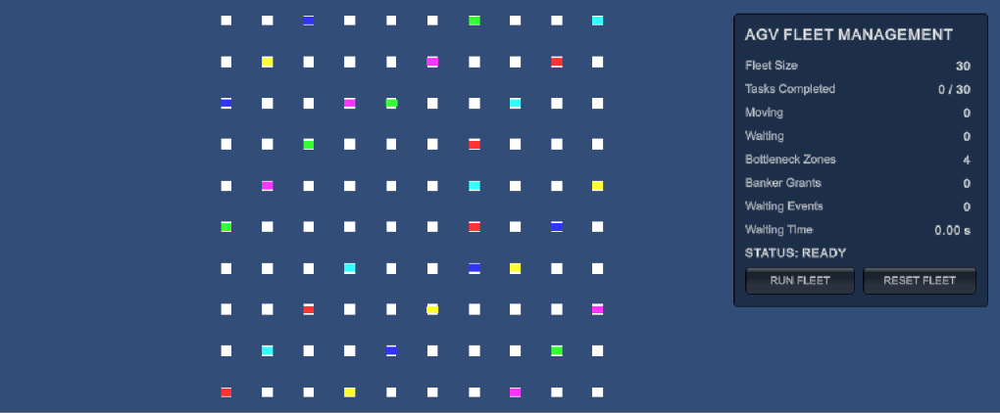
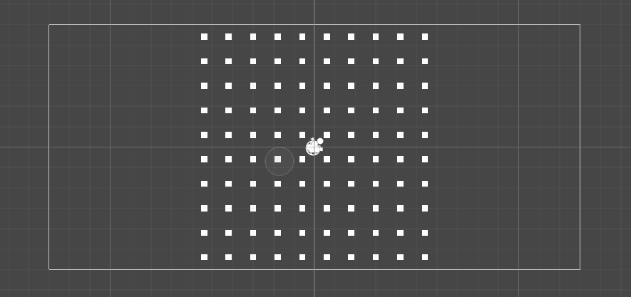

# AGV Fleet Management & Traffic Deadlock Resolution

A Unity-based simulation of an Automated Guided Vehicle (AGV) fleet in a manufacturing-plant environment. The project applies graph theory, hash tables, Banker's Algorithm, and Wait-For Graph cycle detection to study routing and shared-resource management.

## Project Overview

In a manufacturing plant, multiple AGVs transport materials between locations while sharing limited bottleneck zones. Uncoordinated access can create congestion and waiting dependencies. This project models a synthetic plant grid and simulates 30 AGVs travelling between assigned locations while requesting access to shared resources.

### Project Specifications

- **Project:** Automated Guided Vehicle (AGV) Fleet Management & Traffic Deadlock Resolution
- **Engine:** Unity 6.6
- **Language:** C#
- **Plant layout:** 10 × 10 grid
- **Graph nodes:** 100
- **AGV fleet:** 30 vehicles
- **Shared bottleneck resources:** 4 (Nodes 44, 45, 54, and 55)
- **Core DSA concepts:** Graph Theory, Hash Tables, Banker's Algorithm, Wait-For Graph, and DFS

The grid, fleet, task assignments, and routes use synthetic, code-generated data rather than data from a physical factory.

## Features

- Procedural generation of a 100-node plant grid.
- Runtime spawning of a 30-AGV fleet.
- Graph-based route calculation and node-to-node movement.
- Dictionary-based resource ownership tracking.
- Banker's Algorithm safety checks before resource allocation.
- Wait-For Graph representation of AGV waiting dependencies.
- DFS-based cycle detection.
- A separate controlled three-AGV deadlock detection and recovery demonstration.
- Runtime dashboard for task completion, resource grants, waiting events, and cumulative waiting time.
- Algorithm microbenchmark for dictionary lookups and DFS cycle detection.

## Simulation Screenshots

### 30-AGV Fleet and Dashboard



### 10 × 10 Manufacturing-Plant Grid



## Data Structures and Algorithms

### 1. Graph Theory and Pathfinding

The manufacturing plant is represented as a graph, \(G=(V,E)\).

- **Vertices (V):** locations or nodes in the plant.
- **Edges (E):** connections between neighbouring locations.
- **Pathfinding:** calculates a route through the graph to an assigned waypoint and destination.

The grid contains 100 nodes. The current graph builder checks pairs of nodes to establish connectivity, then stores each node's neighbours.

### 2. Hash Tables

The `ResourceManager` uses a C# `Dictionary<int, int>` to map a resource ID to the AGV currently holding it.

Conceptually:

`Resource ID → AGV ID`

Dictionary lookup is average \(O(1)\), which allows the manager to find the current resource owner efficiently. The resource manager also enforces exclusive ownership of each bottleneck.

### 3. Banker's Algorithm

Banker's Algorithm evaluates whether a proposed resource allocation leaves the system in a safe state. The implementation tracks:

- **Available:** currently free resource instances.
- **Allocation:** resources currently held by each AGV.
- **Maximum:** each AGV's declared maximum resource claim.
- **Need:** remaining resource requirement.

The relationship is:

`Need = Maximum − Allocation`

The algorithm tentatively evaluates a request and checks whether a safe sequence exists. Requests that cannot be granted safely are denied and retried by the fleet controller.

### 4. Wait-For Graph and DFS

The Wait-For Graph (WFG) represents AGV-to-AGV waiting dependencies. An edge `AGV A → AGV B` means AGV A is waiting for a resource held by AGV B. DFS searches the graph for cycles, which indicate circular waiting in the modeled single-instance resource system.

A separate controlled three-AGV demonstration illustrates circular waiting, cycle detection, victim selection, resource release, and recovery. The recorded 30-AGV run below did not detect a WFG cycle; these demonstrations are reported separately.

## Implementation

The project was developed in Unity 6.6 with C#.

Key components include:

- `PlantGridGenerator.cs` — generates the plant grid.
- `AGVFleetSpawner.cs` — creates the AGV fleet.
- `AGVNode.cs` and `AGVGraph.cs` — represent nodes and graph connections.
- `PathFinder.cs` — calculates routes through the graph.
- `ResourceManager.cs` — tracks resource ownership.
- `BankersAlgorithm.cs` — performs resource-safety checks.
- `WaitForGraph.cs` — represents waiting dependencies and supports cycle detection.
- `FleetTrafficController.cs` — controls fleet movement and bottleneck requests.
- `FleetTrafficDashboard.cs` — displays live fleet statistics.
- `PerformanceBenchmark.cs` — benchmarks dictionary lookup and DFS operations.

## Recorded Fleet Simulation Results

The following values are from one recorded 30-AGV simulation run. Results can vary between runs.

| Metric | Recorded result |
|---|---:|
| Fleet size | 30 AGVs |
| Graph nodes | 100 |
| Bottleneck resources | 4 |
| Tasks completed | 30 / 30 |
| Resource grants | 63 |
| Waiting events | 42 |
| Cumulative waiting time | 716.86 seconds |
| WFG cycles detected | 0 |
| Deadlocks resolved in this run | 0 |

Cumulative waiting time is the sum of measured waiting intervals across AGVs, not the wall-clock duration of the whole simulation. The 30-AGV run completed all assigned tasks without a detected WFG cycle. Deadlock detection and recovery were demonstrated separately using the controlled three-AGV scenario.

## Algorithm Microbenchmark

The benchmark measures dictionary lookup and DFS cycle-detection time separately over 5,000 repetitions for each fleet-size test. Values are average microseconds per measured operation.

| Fleet size | Dictionary lookup (µs) | DFS (µs) | Combined (µs) |
|---:|---:|---:|---:|
| 5 | 0.0197 | 1.9927 | 2.0124 |
| 10 | 0.0134 | 2.9199 | 2.9333 |
| 15 | 0.0128 | 4.4311 | 4.4439 |
| 20 | 0.0090 | 4.5788 | 4.5878 |
| 25 | 0.0067 | 4.0214 | 4.0281 |
| 30 | 0.0084 | 16.4716 | 16.4800 |

These are algorithm-level measurements, not end-to-end fleet simulation times. The 30-process DFS result is an outlier in this recorded test; additional controlled trials would be needed for a stronger performance comparison. The benchmark uses synthetic test data, including a circular wait-for graph, and is separate from the waiting relationships observed during the 30-AGV simulation.

## Complexity Analysis

Let \(V\) be the number of graph vertices, \(E\) the number of graph edges, \(P\) the number of AGV processes, \(R\) the number of resource types, and \(W\) the number of Wait-For Graph edges.

| Operation | Complexity |
|---|---|
| Adjacency-list graph storage | \(O(V+E)\) |
| Current graph construction | \(O(V^2)\) |
| BFS pathfinding | \(O(V+E)\) |
| Dictionary lookup | \(O(1)\) average |
| Banker's safety check | \(O(P^2R)\) |
| Wait-For Graph DFS | \(O(P+W)\) |

The current graph builder compares pairs of nodes, giving it \(O(V^2)\) construction complexity. The resulting graph is stored using node and neighbour lists.

## Running the Project

### Requirements

- Git
- Unity Hub
- A compatible Unity 6 Editor (developed and tested using Unity 6.6)

### 1. Clone the repository

Open PowerShell or a terminal and run:

```powershell
git clone https://github.com/Samarth-Neema/AGV-fleet-management-deadlock-resolution.git
cd AGV-fleet-management-deadlock-resolution
```

### 2. Open the project in Unity

1. Launch Unity Hub.
2. Select **Add** or **Add project from disk**.
3. Select the cloned repository folder.
4. Open it with a compatible Unity Editor.
5. Open `Assets/Scenes/MainScene.unity`.
6. Enter Play Mode.
7. Use the **RUN FLEET** button on the AGV Fleet Management dashboard.

Unity may take some time to regenerate local `Library` files on the first launch.

## Limitations and Future Work

- The plant is a simplified 2D simulation, not a physical factory model.
- The grid, workload, task assignments, and routes are synthetic.
- The recorded 30-AGV run completed without a detected WFG cycle.
- Deadlock detection and recovery were demonstrated separately with three AGVs.
- Further testing is needed to validate live-fleet recovery under deliberately constructed circular waits.
- Future work includes repeated benchmark trials, richer visualisation, and more extensive traffic scenarios.

---

Developed as an academic Robotics and Automation / Data Structures and Algorithms project.
